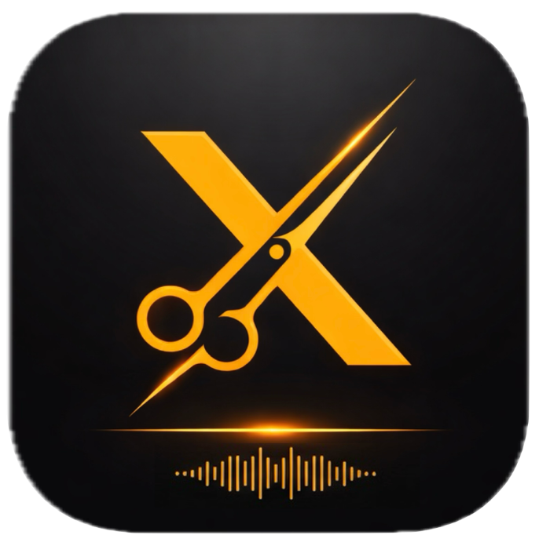
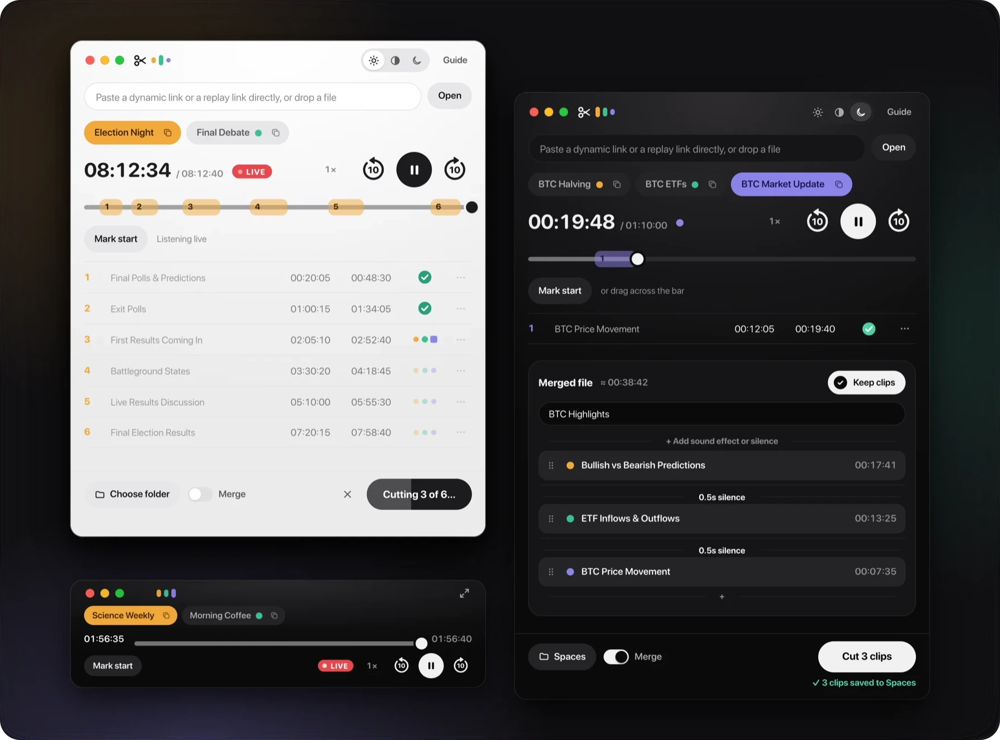

<p align="center">
  
</p>
<h1 align="center">Spacecut</h1>

<p align="center">
  Δωρεάν, ελαφριά, αυτόνομη εφαρμογή για macOS και Windows, με την οποία ακούτε, κόβετε και κατεβάζετε X (Twitter) Spaces.<br/>
  Δεν χρειάζεται εγκατάσταση. Απλώς ανοίξτε την και χρησιμοποιήστε την.
</p>

<p align="center">
  <a href="../../releases/latest">
    
  </a>
  <a href="https://github.com/kostinho09/Spacecut/releases/latest/download/Spacecut-Mac.zip">
    
  </a>
  <a href="https://github.com/kostinho09/Spacecut/releases/latest/download/Spacecut-Windows.zip">
    
  </a>
  <a href="../../releases">
    
  </a>
</p>

<p align="center">
  
</p>

<p align="center">
  <a href="README.md"><b>English</b></a> &nbsp;·&nbsp; <b>Ελληνικά</b>
</p>

---

## Τι νέο έχει η 2.0

Το Spacecut ξαναχτίστηκε από την αρχή.

- **Ελαφρύτερο και γρηγορότερο:** 6–11 φορές μικρότερο (6,43 MB στα Windows, 8,81 MB στο macOS), και κατεβάζει 2–4 φορές πιο γρήγορα.
- **Ενσωματωμένος player:** Ακούστε Spaces και σημειώστε clips στο ίδιο παράθυρο.
- **Live Spaces:** Ακούστε τα όσο είναι live, γυρίστε σε οποιοδήποτε σημείο και κόψτε clips όσο η μετάδοση συνεχίζεται.
- **Μεγάλα Spaces:** Κόψτε και κατεβάστε Spaces οποιασδήποτε διάρκειας, χωρίς σφάλματα.
- Σύρετε πάνω στη γραμμή χρόνου για να επιλέξετε ακριβώς το τμήμα που θέλετε να κόψετε.
- **Ανανεωμένη μετατροπή:** Δουλεύει με τους νέους συνδέσμους που χρησιμοποιεί το X από τα τέλη Οκτωβρίου 2026, τους οποίους το SpaceCutter 1.x δεν μπορεί πλέον να μετατρέψει.
- **Πολλά Spaces δίπλα δίπλα:** Κρατήστε πολλά Spaces ανοιχτά, το καθένα με το δικό του χρώμα.
- Ειδοποιηθείτε κάθε φορά που κυκλοφορεί νέα έκδοση. Προαιρετικό, μπορείτε να το απενεργοποιήσετε όποτε θέλετε.

## Λήψη

Κάθε σύνδεσμος κατεβάζει αμέσως την πιο πρόσφατη έκδοση:
* **[Λήψη για macOS](https://github.com/kostinho09/Spacecut/releases/latest/download/Spacecut-Mac.zip)** (11 ή νεότερο, Apple silicon): μία εφαρμογή, το `Spacecut.app` (το FFmpeg είναι μέσα της)
* **[Λήψη για Windows](https://github.com/kostinho09/Spacecut/releases/latest/download/Spacecut-Windows.zip)** (10 ή 11, 64-bit): ένας φάκελος `Spacecut` με δύο αρχεία: το `Spacecut.exe` και δίπλα του το `ffmpeg.exe`. Κρατήστε τα μαζί.

> [!IMPORTANT]
> Το Spacecut δεν είναι (ακόμα) notarized από την Apple ούτε υπογεγραμμένο με πιστοποιητικό υπογραφής κώδικα της Microsoft, γι' αυτό το macOS και τα Windows θα σας προειδοποιήσουν ότι προέρχεται από άγνωστο developer την πρώτη φορά που θα το ανοίξετε. Αυτό είναι αναμενόμενο, μην πανικοβάλλεστε. Τα Windows βγάζουν αυτό το μήνυμα για κάθε app που δεν έχει πληρώσει τη Microsoft για ένα certificate επαλήθευσης. Το Spacecut είναι δωρεάν εργαλείο και δεν έχει λόγο να ξοδέψει εκατοντάδες δολάρια για να εξαφανίσει ένα παράθυρο.
>
> Θα χρειαστεί να το επιτρέψετε για να ανοίξει. Χρειάζεται μόνο μία φορά:
> - **macOS:** Πηγαίνετε στις Ρυθμίσεις συστήματος → Απόρρητο και ασφάλεια και πατήστε **Άνοιγμα ούτως ή άλλως** (Open Anyway).
> - **Windows:** Όταν τα Windows εμφανίσουν την προειδοποίηση ασφαλείας, πατήστε **Περισσότερες πληροφορίες** → **Εκτέλεση οπωσδήποτε**.

---

## Χαρακτηριστικά

- [x] Αυτόματη μετατροπή link: Επικολλήστε ένα dynamic link και το Spacecut το μετατρέπει αυτόματα σε replay link.
- [x] Ενσωματωμένος player: Ακούστε Spaces και σημειώστε clips.
- [x] Live Spaces: Ακούστε σε πραγματικό χρόνο, γυρίστε πίσω σε οποιοδήποτε σημείο και κόψτε clips όσο το Space είναι ακόμα live.
- [x] **GO LIVE:** Μεταβείτε αμέσως στην πιο πρόσφατη στιγμή του live, με μια ένδειξη που δείχνει πόσο έχει προχωρήσει η μετάδοση.
- [x] Ευέλικτη επιλογή clips: Ορίστε αρχή και τέλος με τα Mark Start και Mark End, ή σύρετε πάνω στη γραμμή χρόνου.
- [x] Γρήγορα timestamps: Γράψτε τα timestamps απευθείας — το `013045` γίνεται αυτόματα `01:30:45`.
- [x] Πολλά Spaces: Δουλέψτε με πολλά Spaces ταυτόχρονα, το καθένα με τη δική του χρωματιστή καρτέλα.
- [x] Μαζική κοπή: Κόψτε πολλά clips με τη μία και παρακολουθήστε την πρόοδο του καθενός ξεχωριστά.
- [x] Αρχική ποιότητα ήχου: Τα clips εξάγονται χωρίς επανακωδικοποίηση, διατηρώντας την αρχική ποιότητα του ήχου.
- [x] Συγχώνευση clips: Ενώστε πολλά clips σε ένα αρχείο ήχου και τακτοποιήστε τα σε όποια σειρά θέλετε με drag and drop.
- [x] Προσαρμοσμένες μεταβάσεις: Προσθέστε ηχητικά εφέ ή σιωπή πριν, ανάμεσα και μετά από τα clips που ενώνονται.
- [x] Τοπικά αρχεία: Εξαγάγετε τον ήχο από τοπικά αρχεία βίντεο και ήχου και αποθηκεύστε τον σε μορφή `.m4a`.
- [x] Χειριστήρια αναπαραγωγής: Ρυθμίστε την ταχύτητα από 0.5× έως 2× και μετακινηθείτε μπροστά ή πίσω ανά 10 δευτερόλεπτα.
- [x] Ειδοποιήσεις ολοκλήρωσης: Ειδοποιηθείτε όταν τελειώσει μια κοπή. (Μόνο στην έκδοση για macOS)
- [x] Εμφάνιση: Επιλέξτε φωτεινή ή σκοτεινή εμφάνιση, ή ακολουθήστε αυτόματα τις ρυθμίσεις του συστήματός σας.

---

## Οδηγίες χρήσης

### 1. Πάρτε το Dynamic (Live) link όσο το Space είναι live

1. Ανοίξτε το Space στον browser σας.
2. Πατήστε **F12**, ή κάντε δεξί κλικ στη σελίδα και επιλέξτε **Inspect**, για να ανοίξουν τα Developer Tools.
3. Πηγαίνετε στην καρτέλα **Network**.
4. Γράψτε `dynamic` στο πεδίο φίλτρου.
5. Βρείτε το request που περιέχει `dynamic_playlist.m3u8?type=live`.
6. Κάντε δεξί κλικ πάνω του → **Copy** → **Copy URL**.

> **Συμβουλή:** Αποθηκεύστε το Dynamic link όσο το Space είναι live. Μπορείτε να το χρησιμοποιήσετε για να φτιάξετε Replay link όποτε χρειαστεί, έως 30 ημέρες μετά το τέλος του Space.

### 2. Μετατρέψτε το σε Replay link

Επικολλήστε το Dynamic (Live) link στο πεδίο στο πάνω μέρος του Spacecut. Θα μετατραπεί αυτόματα σε Replay link, που ανοίγει στον ενσωματωμένο player.

Μπορείτε να μετατρέψετε ένα Dynamic link οποιαδήποτε στιγμή, ακόμα και αφού τελειώσει το Space, αρκεί να το έχετε αποθηκεύσει. Η μετατροπή είναι δυνατή έως **30 ημέρες μετά το τέλος του Space**. Αν μετατρέψετε το Dynamic link όσο το Space είναι ακόμα live, το Replay link που θα προκύψει θα περιέχει ό,τι έχει μεταδοθεί μέχρι εκείνη ακριβώς τη στιγμή.

### Για ηχογραφημένο Space που έχει τελειώσει

Αν ο host ενεργοποίησε την ηχογράφηση, μπορείτε να πάρετε το Replay link αφού τελειώσει το Space:

1. Ανοίξτε το Space στον browser σας.
2. Πατήστε **F12**, ή κάντε δεξί κλικ στη σελίδα και επιλέξτε **Inspect**, και πηγαίνετε στην καρτέλα **Network**. Γράψτε `m3u8` στο πεδίο φίλτρου **πριν** πατήσετε Play.
3. Πατήστε **Play recording**.
4. Βρείτε το request που περιέχει `playlist_….m3u8?type=replay`.
5. Κάντε δεξί κλικ πάνω του, επιλέξτε **Copy → Copy URL** και επικολλήστε το URL στο Spacecut.

Το request της λίστας στέλνεται μόνο μία φορά, όταν πατάτε Play. Αν ανοίξετε την καρτέλα Network αφού έχει ήδη ξεκινήσει η αναπαραγωγή, ανανεώστε τη σελίδα και πατήστε ξανά **Play recording**.

Μπορείτε επίσης να πάρετε το link από οποιοδήποτε κομμάτι ήχου: γράψτε `chunk` στο πεδίο φίλτρου και αντιγράψτε ένα URL που περιέχει `…/audio-space/chunk_….aac`. Μετά αντικαταστήστε ό,τι υπάρχει μετά το `audio-space/` με `playlist_0.m3u8?type=replay`.


---

## Απόρρητο

Το Spacecut λειτουργεί εξ ολοκλήρου στον υπολογιστή σας. Συνδέεται μόνο στους servers του X, για να πάρει τον ήχο των Spaces που προσθέτετε, και όταν το ανοίγετε ελέγχει αν υπάρχει νέα έκδοση, κάτι που μπορείτε να απενεργοποιήσετε όποτε θέλετε. Δεν αποστέλλεται τίποτα που να αφορά εσάς. Δεν υπάρχουν λογαριασμοί, analytics, telemetry, cookies ή αρχεία καταγραφής.

## Συνεισφορά

Αναφορές σφαλμάτων, ιδέες και pull requests είναι ευπρόσδεκτα. Για να φτιάξετε την εφαρμογή χρειάζεστε [Rust](https://rustup.rs) και το Tauri CLI:

```
cargo install tauri-cli --locked
```

Σε Mac χρειάζεστε επίσης τα command line tools του Xcode: `xcode-select --install`.

Μετά τρέξτε `cargo tauri dev` στον φάκελο `src-tauri`.

## Άδεια

Το Spacecut είναι ελεύθερο λογισμικό με άδεια [GNU GPL v3](LICENSE). Περιλαμβάνει το FFmpeg· δείτε το [NOTICE.md](NOTICE.md).

---

Έχεις σχόλια, κάποια απορία, βρήκες σφάλμα ή έχεις ιδέα για νέα λειτουργία; Πες μου μέσα από [αυτή τη φόρμα](https://tally.so/r/VpQMDj). · X: [@kostinho__](https://x.com/kostinho__)
