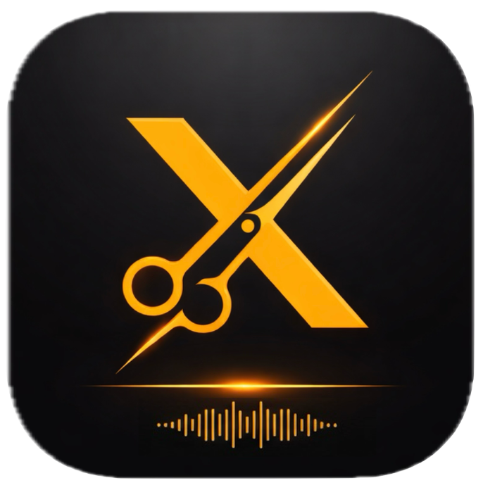
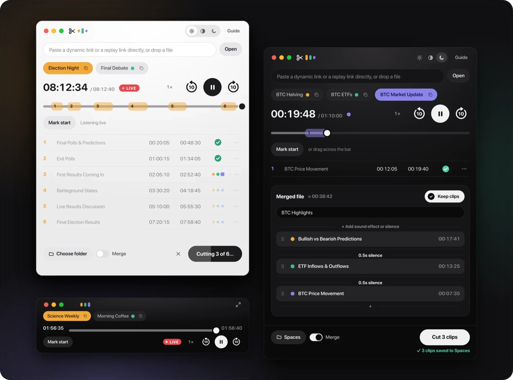
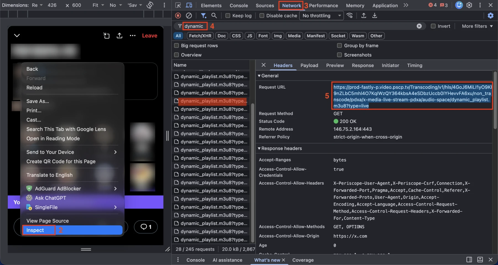

<p align="center">
  
</p>
<h1 align="center">Spacecut</h1>

<p align="center">
  A free, lightweight, standalone desktop app for macOS and Windows that lets you listen to, cut, and download X (Twitter) Spaces.<br/>
  No installation required. Just open and use.
</p>

<p align="center">
  <a href="../../releases/latest">
    
  </a>
  <a href="https://github.com/kostinho09/Spacecut/releases/latest/download/Spacecut-Mac.zip">
    
  </a>
  <a href="https://github.com/kostinho09/Spacecut/releases/latest/download/Spacecut-Windows.zip">
    
  </a>
</p>

<p align="center">
  
</p>

<p align="center">
  <b>English</b> &nbsp;·&nbsp; <a href="README.el.md"><b>Ελληνικά</b></a>
</p>

---

## What's new in 2.0

Spacecut has been rebuilt from the ground up.

- **Lightweight and faster:** 6–11× smaller (6.43 MB on Windows, 8.81 MB on macOS), and downloads 2–4× faster.
- **Built-in player:** Listen to Spaces and mark clips in the same window.
- **Live Spaces:** Listen while they're live, go back to any moment, and cut clips while the broadcast is still running.
- **Long Spaces:** Cut and download Spaces of any length, without errors.
- Drag across the timeline to select exactly the section you want to cut.
- **Updated converter:** Works with the new links X has used since late October 2026, which SpaceCutter 1.x can no longer convert.
- **Multiple Spaces side by side:** Keep several Spaces open, each with its own colour.
- Get notified whenever a new version is available. Optional, you can turn it off at any time.

## Download

Each link downloads the latest version at once:
* **[Download for macOS](https://github.com/kostinho09/Spacecut/releases/latest/download/Spacecut-Mac.zip)** (11 or later, Apple silicon): a single app, `Spacecut.app` (FFmpeg is inside it)
* **[Download for Windows](https://github.com/kostinho09/Spacecut/releases/latest/download/Spacecut-Windows.zip)** (10 or 11, 64-bit): a `Spacecut` folder with two files: `Spacecut.exe` and `ffmpeg.exe` beside it. Keep them together.

> [!IMPORTANT]
> Spacecut is not notarized by Apple or signed with a Microsoft code-signing certificate (yet 👀), so macOS and Windows will warn you the first time you open it. This is expected.
>
> You'll need to allow it before it opens. You only need to do this once:
> - **macOS:** Go to System Settings → Privacy & Security and click **Open Anyway**.
> - **Windows:** When Windows shows its SmartScreen security warning, click **More info** → **Run anyway**.<br>If SAC (Smart App Control) is on, Windows 11 will block it.

---

## Features

- [x] Automatic link conversion: Paste a dynamic link and Spacecut automatically converts it into a replay link.
- [x] Built-in player: Listen to Spaces and mark clips.
- [x] Live Spaces: Listen in real time, jump back to any point, and cut clips while the Space is still live.
- [x] **GO LIVE:** Instantly jump to the latest live moment, with an indicator showing how far the broadcast has progressed.
- [x] Flexible clip selection: Set start and end points with Mark Start and Mark End, or drag across the timeline.
- [x] Quick timestamps: Enter timestamps directly — `013045` automatically becomes `01:30:45`.
- [x] Multiple Spaces: Work with several Spaces simultaneously, each with its own colour-coded tab.
- [x] Original audio quality: Clips are extracted without re-encoding, preserving the original audio quality.
- [x] Clip merging: Combine multiple clips into a single audio file and arrange them in any order using drag and drop.
- [x] Custom transitions: Add sound effects or silence before, between, and after merged clips.
- [x] Local media support: Extract audio from local video and audio files and save it in `.m4a` format.
- [x] Completion notifications: Get notified when a cutting operation is finished. (Only in macOS version)
- [x] Appearance: Choose between light and dark mode or automatically follow your system settings.

---

## How to Use

### 1. Get the Dynamic (Live) link while the Space is live

1. Open the Space in your browser.
2. Press **F12**, or right-click the page and choose **Inspect**, to open the Developer Tools.
3. Go to the **Network** tab.
4. Type `dynamic` in the filter box.
5. Find the request containing `dynamic_playlist.m3u8?type=live`.
6. Right-click it → **Copy** → **Copy URL**.

<details>
<summary><b>See <ins>example</ins></b></summary>
<br>

</details>

### 2. Convert it to a Replay link

Paste the Dynamic (Live) link into the field at the top of Spacecut. It will automatically convert it into a Replay link, which opens in the built-in player.

You can convert a Dynamic link at any time, even after the Space has ended, as long as you have saved it. The conversion remains possible for up to **30 days after the Space ends**. If you convert the Dynamic link while the Space is still live, the resulting Replay link will contain everything up to that exact moment.

### For a recorded Space that has ended

If the host enabled recording, you can retrieve the Replay link after the Space has ended:

1. Open the Space in your browser.
2. Press **F12**, or right-click the page and choose **Inspect**, and go to the **Network** tab. Enter `m3u8` in the filter box **before** pressing Play.
3. Click **Play recording**.
4. Look for a request containing `playlist_….m3u8?type=replay`.
5. Right-click the request, select **Copy → Copy URL**, and paste the URL into Spacecut.


---

## Privacy

Spacecut runs entirely on your computer. It connects only to X's servers, to get the audio of the Spaces you add, and when you open it it checks for a new version, but you can turn this off at any time. Nothing about you is sent. There are no accounts, analytics, telemetry, cookies or log files.

## Contributing

Bug reports, ideas and pull requests are welcome. To build the app you need [Rust](https://rustup.rs) and the Tauri CLI:

```
cargo install tauri-cli --locked
```

On a Mac you also need Xcode's command line tools: `xcode-select --install`.

Then run `cargo tauri dev` in the `src-tauri` folder.

## License

Spacecut is free software under the [GNU GPL v3](LICENSE). It includes FFmpeg; see [NOTICE.md](NOTICE.md).

---

Have feedback, a question, found a bug, or an idea for a new feature? Let me know using [this form](https://tally.so/r/VpQMDj). · X: [@kostinho__](https://x.com/kostinho__)
